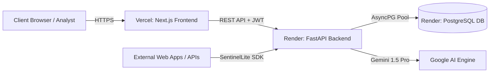

# 🌐 Production Deployment Guide: Render & Vercel

This guide explains how to deploy **SentinelLite** to production using **Render** (Backend API + Managed PostgreSQL) and **Vercel** (Next.js SOC Frontend).

---

## Architecture Overview



---

## Part 1: Backend Deployment on Render

### Method A: Blueprint 1-Click Setup (Recommended)
1. Fork or push your code to your GitHub repository: `https://github.com/Arpan-yadav/Sentinel-Lite`.
2. Log in to [Render Dashboard](https://dashboard.render.com).
3. Click **New +** → **Blueprint**.
4. Connect your `Sentinel-Lite` repository.
5. Render will automatically read [`render.yaml`](../render.yaml) and create:
   - **`sentinellite-db`**: PostgreSQL Managed Instance (Free Tier).
   - **`sentinellite-api`**: Python Web Service running `uvicorn app.main:app`.
6. Under `sentinellite-api` environment variables, add your `GEMINI_API_KEY` (if utilizing Google Gemini).
7. Copy your backend service URL: `https://sentinellite-api.onrender.com`.

### Method B: Manual Render Setup
1. **Create Database**:
   - New **PostgreSQL** → Name: `sentinellite-db`, Database: `sentinellite`, User: `sentinellite`.
   - Copy the **Internal Database URL**.
2. **Create Web Service**:
   - New **Web Service** → Connect `Sentinel-Lite`.
   - **Root Directory**: Leave blank (root).
   - **Environment**: `Python 3`.
   - **Build Command**: `pip install -r backend/requirements.txt`.
   - **Start Command**: `cd backend && uvicorn app.main:app --host 0.0.0.0 --port $PORT`.
   - **Environment Variables**:
     | Key | Value |
     | :--- | :--- |
     | `DATABASE_URL` | *(Paste Internal Database URL from step 1)* |
     | `SECRET_KEY` | *(Generate a 32-character random string)* |
     | `CORS_ORIGINS` | `https://*.vercel.app,http://localhost:3000` |
     | `ACCESS_TOKEN_EXPIRE_MINUTES` | `480` |
     | `GEMINI_API_KEY` | *(Your Gemini API key)* |

---

## Part 2: Frontend Deployment on Vercel

1. Log in to [Vercel](https://vercel.com).
2. Click **Add New...** → **Project**.
3. Import your `Sentinel-Lite` repository.
4. In the Project Configuration:
   - **Root Directory**: Click `Edit` and select `frontend`.
   - **Framework Preset**: `Next.js`.
   - **Build Command**: `pnpm build` (default).
   - **Output Directory**: `.next` (default).
5. **Environment Variables**:
   Add the following environment variable:
   | Key | Value |
   | :--- | :--- |
   | `NEXT_PUBLIC_API_URL` | `https://sentinellite-api.onrender.com/api/v1` |
6. Click **Deploy**.
7. Once deployed, copy your Vercel URL (e.g. `https://sentinellite-soc.vercel.app`).
8. Return to Render and ensure `CORS_ORIGINS` includes your custom Vercel domain!

---

## Part 3: Production Database Seeding

To seed your production Render database with default administrative accounts and the authentic CICIDS2017 dataset:

```bash
# Set your production API URL
export SENTINEL_API_URL="https://sentinellite-api.onrender.com/api/v1"

# Run the authentic seeding script
python scripts/seed_authentic.py
```

Default credentials:
- **Admin**: `admin@sentinellite.io` / `AdminPass123!`
- **Analyst**: `analyst@sentinellite.io` / `AnalystPass123!`

---

## Part 4: Production Verification Checklist

- [x] Backend responds to `GET /health` with `{"status": "healthy"}`
- [x] Frontend loads dashboard at Vercel URL with dual light/dark SOC theme
- [x] Login succeeds with JWT stored in secure session cookie
- [x] Authentic CICIDS2017 events visible in Events Telemetry table
- [x] Correlated Incidents display interactive Temporal Knowledge Graphs (TKG)
- [x] MITRE ATT&CK next-kill-chain predictions render with confidence bars
- [x] Active Defense dynamic IP blocklist accessible at `/api/v1/defense/blocklist`
- [x] Python / Node.js SDKs can pull blocklist rules and push telemetry
